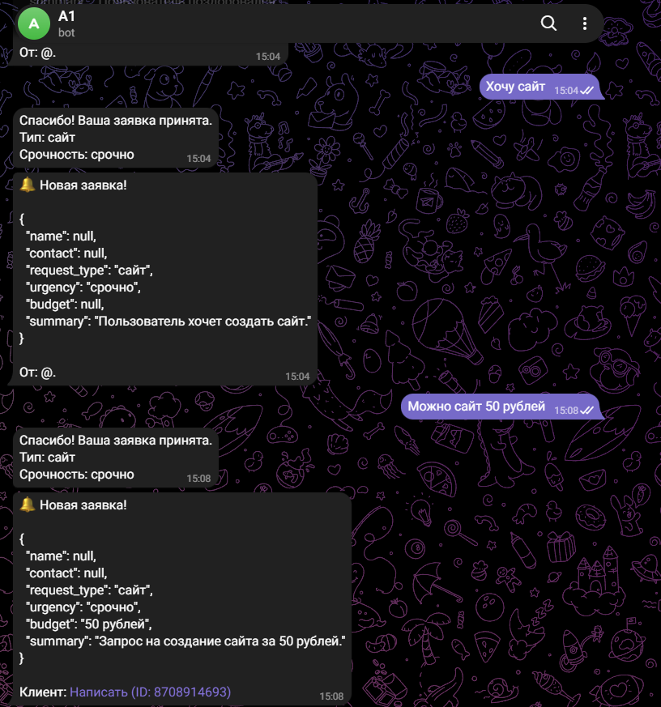
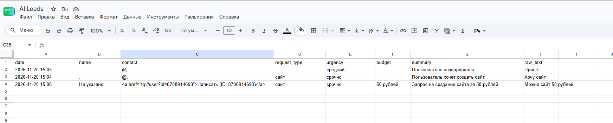

AI Lead Processor (Telegram Bot)

Асинхронный Telegram-бот, который автоматизирует обработку входящих заявок с помощью нейросети (LLM). Бот извлекает структурированные данные из свободного текста клиента, сохраняет их в Google Sheets и присылает уведомление администратору.

Менеджерам больше не нужно вручную читать каждое сообщение и заносить данные в таблицу. Бот работает как «первая линия поддержки»: он принимает заявку, понимает её суть, определяет срочность и бюджет, а затем передает лид в удобном формате.

##
- Понимает естественный язык: Извлекает имя, контакт, тип запроса, срочность и бюджет из любого текста.
- Интеграция с Google Sheets: Автоматически создает новую строку в таблице с разобранными данными.
- Умные уведомления: Отправляет администратору в Telegram структурированный JSON и кликабельную ссылку на клиента (даже если у него нет никнейма).

* Язык: Python 3
* Нейросеть: API AIAI.BY
* Интеграции: Google Sheets API

Проект развернут на облачном хостинге blitz.cloud. 
Благодаря поддержке фоновых процессов бот работает автономно на бесплатном сервере без режима сна

  <b>Попробовать бота вживую:</b> 
  

**[Посмотреть живую таблицу в Google Sheets](https://docs.google.com/spreadsheets/d/1xiS27YuE6-o_y4QSSWrNUdhbto9bDQzkZBm-BMSHYag/edit?usp=sharing)**
